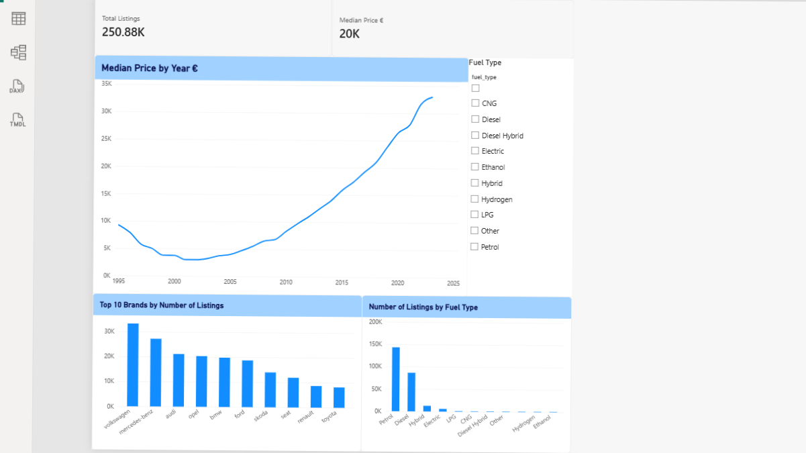

# German Used Car Market Analysis 🚗

Analysis of about **250,000 used car listings** from AutoScout24 (Germany, cars built 1995–2023).
The goal: understand **what affects used car prices** in Germany.

## Tools
- **Python** (Pandas, NumPy, Matplotlib) – data cleaning and analysis
- **Power BI** – interactive dashboard

## Data
- Source: [Germany Used Cars Dataset 2023 (Kaggle)](https://www.kaggle.com/datasets/wspirat/germany-used-cars-dataset-2023)
- The CSV files are not included here because they are too large for GitHub (>25 MB).

## Data Cleaning
The raw data was scraped from a website and was messy. Main steps:
- Removed **199 rows** (~0.08%) where values were shifted into the wrong columns.
- Converted text columns (year, price, power, mileage, fuel consumption, CO₂) to numbers.
- Fixed German number format (`4,9` → `4.9`) and removed units (`l/100 km`, `g/km`).
- Replaced impossible values with missing values instead of deleting the whole car, for example:
  - fuel consumption of 0 or above 30 l/100 km
  - CO₂ of 0 for non-electric cars, and placeholder values like 999 g/km
  - mileage above 1,000,000 km
- Replaced `Unknown` with missing values and removed duplicate columns.

## Key Findings
1. **Age is the strongest price factor.** Median price drops from about €33k (2023) to about €8k (2010) – roughly half every 5 years.
2. **High mileage means low price.** Cars with low mileage can be cheap or expensive; cars with very high mileage are almost always cheap.
3. **Electric and hybrid cars** have a higher median price (~€30k) than petrol cars (~€18k), partly because they are newer.
4. **Brand comparison needs care.** Toyota looked like the most expensive top brand, but its listings are much newer (median year 2021 vs. 2015 for BMW and Mercedes). Age was a hidden factor.
5. **Volkswagen, Mercedes-Benz and Audi** have the most listings.

## Limitations
- Prices are **asking prices** in ads, not final sale prices.
- Some plug-in hybrids are labelled as "Petrol" in the source data.
- Brands with very few listings (e.g. Chrysler, 32 cars) were not compared, because the sample is too small.

## Files
| File | Description |
|---|---|
| `01_used_cars_analysis.ipynb` | Data cleaning and analysis in Python |
| `used_cars_dashboard.pbix` | Power BI dashboard |
| `dashboard.png` | Dashboard screenshot |

## Author
**Sanaz Afsharnik** – M.Sc. Applied Informatics, University of Bamberg
